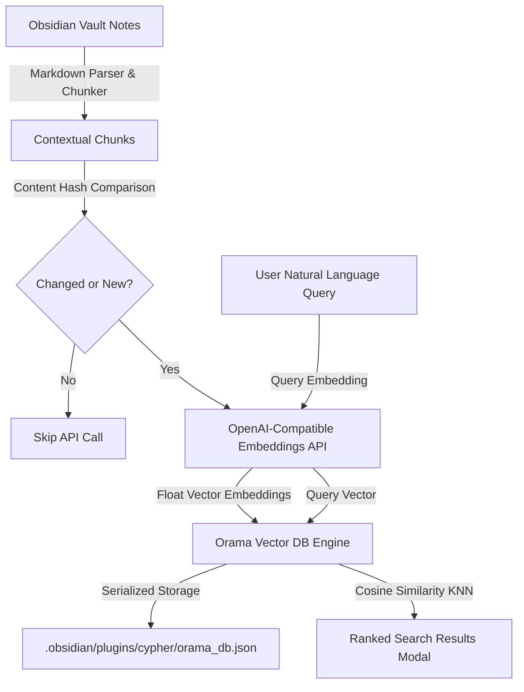

# Cypher ⚡
### AI Vector Search & Embedded Vector Database for Obsidian

**Cypher** is a high-performance Obsidian plugin that transforms your entire vault into an embedded vector database. Using any OpenAI-compatible embedding API (including OpenAI, local Ollama, LM Studio, OpenRouter, and more), Cypher creates semantic vector embeddings for all your markdown notes, enabling instant, natural-language search across your thoughts and knowledge base.

---

## ✨ Features

- **🚀 Automated First-Run Setup & Onboarding**:
  - Automatically launches an interactive wizard on first installation.
  - Tests API connectivity and auto-detects model dimensions (e.g., 1536 for OpenAI `text-embedding-3-small`, 768 for Ollama `nomic-embed-text`).
  - Scans your vault and indexes all markdown notes with a live progress bar, pause/resume controls, and chunk counters.

- **💾 Embedded Vector Database (Orama WASM/TS)**:
  - Runs 100% locally inside the plugin itself (`.obsidian/plugins/cypher/orama_db.json`).
  - Zero external database services or native binary dependencies (`node-gyp`).
  - Persisted atomically to your vault via Obsidian's DataAdapter API.

- **🧠 Smart Heading-Aware Markdown Chunking**:
  - Understands markdown structure, preserving heading hierarchy (e.g. `[Note: Ideas | Implementation Plan]`) so every vector is semantically grounded.
  - Strips frontmatter while maintaining note metadata.
  - Paragraph-aware chunking with customizable chunk size and overlap.

- **⚡ Incremental Indexing & Hash Caching**:
  - Fast content hashing (FNV-1a) ensures notes are only embedded when they change.
  - Skips unchanged notes during re-indexing, saving API tokens, bandwidth, and time.
  - Live vault listeners: automatically updates vectors when a note is edited, cleans up deleted notes, and updates renamed files.

- **🔍 Built-in Semantic Search Modal**:
  - Search your vault using conversational natural language queries.
  - Shows similarity match scores (e.g., `94% match`), note title, heading breadcrumbs, and preview snippets.
  - Keyboard navigation (Arrow keys, Enter to navigate directly to the note).

- **🌐 Broad AI Compatibility**:
  - **OpenAI**: `text-embedding-3-small`, `text-embedding-3-large`, `text-embedding-ada-002`
  - **Ollama (Local & Free)**: `nomic-embed-text`, `bge-m3`, `all-minilm`
  - **LM Studio (Local)**: Any embedding GGUF model via Local Server
  - **OpenRouter & Custom**: Any endpoint implementing `/v1/embeddings`

---

## 🛠️ Architecture Overview



---

## 📦 Installation & Setup

### Development / Manual Installation
1. Clone or copy this repository into your Obsidian vault's plugins folder:
   ```bash
   <your-vault>/.obsidian/plugins/cypher
   ```
2. Build the plugin bundle:
   ```bash
   npm install
   npm run build
   ```
3. In Obsidian:
   - Go to **Settings** → **Community Plugins**.
   - Enable community plugins if disabled.
   - Reload plugins and toggle **Cypher** on.

### First-Time Onboarding
Upon enabling the plugin for the first time, Cypher will automatically open the **Setup Wizard**:
1. Select a provider preset (e.g., *OpenAI*, *Ollama Local*, *LM Studio*).
2. Enter your API Key (or leave blank if using a local Ollama server).
3. Click **Test Connection & Auto-Detect Dimensions**.
4. Click **Start Vault Indexing →** to vectorize your vault.

---

## ⌨️ Commands

| Command | Action |
|---|---|
| `Cypher: Semantic Search Vault` | Opens the semantic vector search popup modal |
| `Cypher: Update Vault Index (Incremental)` | Scans vault and embeds only new or modified notes |
| `Cypher: Rebuild Entire Vault Index` | Forces a complete re-embedding of the vault |
| `Cypher: Run First-Time Setup Wizard` | Re-opens the interactive onboarding wizard |

---

## 🧪 Testing

Run the included automated test suite (verifying markdown chunking, vector indexing, similarity search, and persistence):
```bash
npm test
```

---

## 📄 License
MIT
